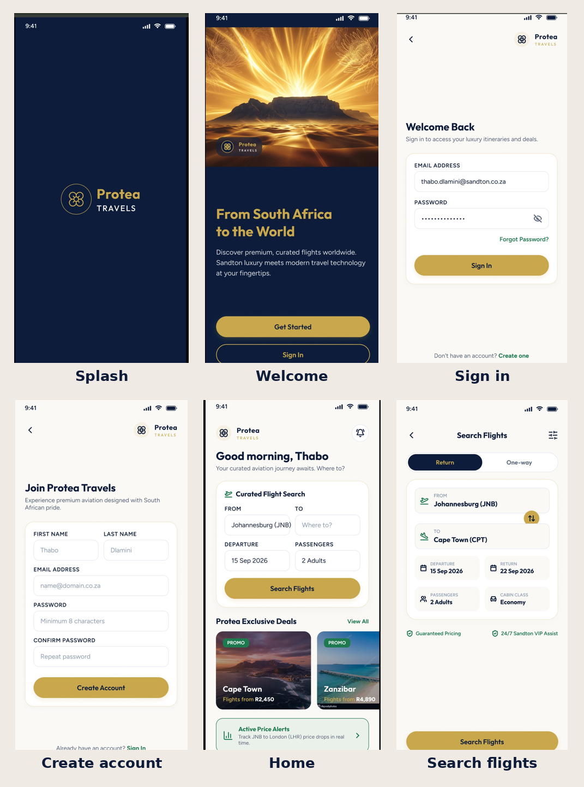

# Protea Travels (Android · Kotlin · Jetpack Compose · Firebase)

Protea Travels is a flight-booking app for South African travellers: register or sign in (email, Google or Facebook), search and book flights, manage trips and price alerts, see destination weather, work offline, and use the app in English, isiZulu or Afrikaans. It is written in Kotlin with Jetpack Compose, and uses Firebase (Authentication, Firestore, Cloud Messaging) as its online backend.

**Contents**
- [Mockups](#mockups)
- [Automated testing](#automated-testing)
- [Setup and run (sections 1–14)](#1-install-first)
- [Version control and commits](#version-control-and-commits)
- [How AI was used in this project](#how-ai-was-used-in-this-project)

## Mockups

The screens below were the design reference the app was built against. Full-size originals are in `/mockups`.



| Screen | File |
|---|---|
| Splash | `mockups/01-splash.jpeg` |
| Welcome | `mockups/02-welcome.jpeg` |
| Sign in | `mockups/03-signin.jpeg` |
| Create account | `mockups/04-register.jpeg` |
| Home | `mockups/05-home.jpeg` |
| Search flights | `mockups/06-search.jpeg` |

## Automated testing

The project has **54 automated unit tests** and **5 automated Room (database) tests**. They check the app's rules and calculations without needing Firebase or an internet connection, so they give the same result every time.

| Test file | Tests | What it checks |
|---|---|---|
| `app/src/test/.../data/ValidationTest.kt` | 21 | email format, registration rules, login rules, every search-form rule (empty fields, same airport, past date, return before departure, badly typed dates) |
| `app/src/test/.../data/PricingTest.kt` | 10 | trip totals (passengers × cabin class × return trip) and `R2,450` / `US$132` formatting |
| `app/src/test/.../data/ModelsTest.kt` | 7 | default settings and search values, airport labels |
| `app/src/test/.../data/WeatherTest.kt` | 9 | weather-code wording, parsing good / bad / empty API responses, coordinates for every airport |
| `app/src/test/.../i18n/StringsTest.kt` | 7 | English, isiZulu and Afrikaans are all complete and genuinely different |
| `app/src/androidTest/.../RoomOfflineTest.kt` | 5 | offline flight cache and the queue of bookings/alerts waiting to sync (needs an emulator) |

**How to run them**
1. In Android Studio switch the Project panel to the **Project** view.
2. Right-click `app/src/test/java` and choose **Run 'Tests in ...'**. (Or run `./gradlew testDebugUnitTest` in a terminal.)
3. The **Run** panel at the bottom shows a green tick for every passing test. The HTML report is at `app/build/reports/tests/testDebugUnitTest/index.html`.
4. For the Room tests, start an emulator, then right-click `RoomOfflineTest.kt` > **Run 'RoomOfflineTest'**.

**Automatic testing on GitHub:** `.github/workflows/android-ci.yml` runs the unit tests on every push and pull request, and uploads the test report as a downloadable artifact (see section 8).

**My test run:** *(replace this line with your own screenshot, e.g. ``, after you run the tests on your machine, and write the real result, e.g. "54 of 54 passed".)*

**Not covered by automated tests:** the Firebase calls (sign-in, Firestore, push notifications) and the screens themselves, because they need a live Firebase project or a device. They are demonstrated in the demo video instead.

## 1. Install first
- Android Studio (Koala or newer) with the bundled JDK 17
- SDK Platform 34 (SDK Manager > SDK Platforms > Android 14 "UpsideDownCake")
- An emulator (Pixel, API 34) or a physical phone with USB debugging
- A free Google account for Firebase

## 2. Create the online backend (Firebase)
1. https://console.firebase.google.com > Add project > "ProteaTravels"
2. Project overview > Add app > Android. Package name MUST be: com.protea.travels. Register app.
3. Download google-services.json and put it in: ProteaTravels/app/google-services.json
4. Build > Authentication > Get started > Sign-in method > enable Email/Password
5. Build > Firestore Database > Create database > Start in production mode > pick a region (e.g. europe-west / africa if offered)
6. Firestore > Rules tab > paste the contents of firestore.rules > Publish

## 3. Open and run
1. Unzip. Android Studio > File > Open > select the ProteaTravels folder.
2. Let Gradle sync (needs internet). If asked about the Gradle wrapper, accept.
   If sync says the wrapper jar is missing: Settings > Build Tools > Gradle > "Use Gradle from: gradle-wrapper.properties" or choose the bundled Gradle.
3. Do NOT accept "upgrade AGP/Kotlin" prompts until it runs once (versions are pinned to work together).
4. Run > app. First login seeds the flights collection in Firestore.

## 4. Dependencies used (already in app/build.gradle.kts)
- Jetpack Compose BOM + Material3 + material-icons-extended
- navigation-compose, lifecycle-viewmodel-compose, activity-compose, appcompat (per-app language)
- Firebase BoM: firebase-auth-ktx, firebase-firestore-ktx, firebase-messaging-ktx
- kotlinx-coroutines-play-services (.await() on Firebase tasks)
- play-services-auth (Google Sign-In), facebook-login (Facebook Login)
- Room (room-runtime, room-ktx, room-compiler via KSP) for the offline cache
- OkHttp + org.json for the weather API call
- Plugins: com.google.gms.google-services, com.google.devtools.ksp

## 5. Rubric mapping
| Requirement | Where |
|---|---|
| Register / login | AuthScreens.kt, Repo.register/login. Passwords are hashed and stored by Firebase Auth; the app never stores them. |
| Single sign-on (Google & Facebook) | ui/SocialAuth.kt, Repo.signInWithGoogle/signInWithFacebook — see section 10 to configure |
| Settings | SettingsScreen (name, dark mode, currency, default airport, language, notifications) saved to Firestore per user |
| Online API + DB | Firebase Auth + Cloud Firestore (hosted by Google, accessed over HTTPS) |
| Flight search (return / one-way, dates, passengers, cabin) | SearchScreen + Repo.searchFlights |
| Results, booking, my trips (create/read/delete) | ResultsScreen, BookingsScreen |
| Deals and price alerts (create/read/delete) | HomeScreen |
| Offline mode with sync | data/local/* (Room), Repo.searchFlights/addBooking/addAlert/syncPending — see section 11 |
| Real-time push notifications | push/ProteaMessagingService.kt, push/NotificationHelper.kt — see section 12 |
| Multi-language support (English, isiZulu, Afrikaans) | i18n/Strings.kt, language picker in Settings — see section 13 |
| Weather feature | data/WeatherRepo.kt, WeatherCard in MainScreens.kt — see section 14 |

## 6. Demo script
Register > sign out > sign in > tap a deal > search return flight (note the weather card) > book > see it in Trips > cancel > add a price alert > change settings (dark mode, currency, language) > sign out and back in to show settings persisted in the cloud > turn on airplane mode, book a flight, show it queues, turn connectivity back on and show it syncs.

## 7. Before submitting
Firestore rules currently let signed-in users write to `flights` so the app can seed demo data. After the first run, change that line to `allow write: if false;` and republish.

## 8. Continuous integration (GitHub Actions)
`.github/workflows/android-ci.yml` builds the debug APK and runs lint on every push and pull request to `main`. It calls `./gradlew`, which this zip does **not** include (it's a binary generated per-project, not something to hand-copy between projects) — one extra step is needed before pushing:
1. Open the project in Android Studio once and let it sync (section 3). This generates `gradlew`, `gradlew.bat` and `gradle/wrapper/gradle-wrapper.jar` in the project root.
2. `git add -A` and commit those generated files along with the rest of the project — the CI workflow has nothing to run without them.
3. Push this project to a GitHub repository.
4. Go to **Settings > Secrets and variables > Actions > New repository secret**, name it `GOOGLE_SERVICES_JSON`, and paste the full contents of your `google-services.json` as the value (the file itself is never committed, since it's specific to your Firebase project).
5. Push a commit. The **Actions** tab shows the build running, and a downloadable `app-debug` APK once it succeeds.

See the project report for the fuller explanation of how GitHub and GitHub Actions were used.

## 9. Enable Room (offline mode) — nothing to configure
Room is local-only, so there is no console setup for it. The first time you search a route while online, that route's results are cached automatically; if you then lose connectivity and search the same route again, you'll see the cached results with an offline banner instead of an error. Booking a flight or adding a price alert while offline queues it locally (Settings shows how many actions are waiting); it's sent to Firestore automatically, with no action needed from the user, the moment the device reconnects.

## 10. Configure single sign-on (Google & Facebook)
**Google:**
1. Firebase console > Authentication > Sign-in method > enable **Google**.
2. Still on that screen, Firebase shows a **Web client ID** ending in `.apps.googleusercontent.com` — copy it.
3. Open `app/src/main/res/values/strings.xml` and replace `google_web_client_id` with that value.

**Facebook:**
1. Create an app at developers.facebook.com (type: Consumer), then Products > add **Facebook Login**.
2. In the Facebook app's Settings > Basic, copy the **App ID** and **Client Token** (Advanced section).
3. In `app/src/main/res/values/strings.xml`, replace `facebook_app_id` with the App ID, `facebook_client_token` with the Client Token, and `fb_login_protocol_scheme` with `fb` followed by your App ID (e.g. `fb1234567890123`).
4. Still in the Facebook app, add a package with package name `com.protea.travels`, your default activity class name `com.protea.travels.MainActivity`, and a key hash. Get the debug key hash by running (requires OpenSSL; on Windows use Git Bash):
   ```
   keytool -exportcert -alias androiddebugkey -keystore %USERPROFILE%\.android\debug.keystore | openssl sha1 -binary | openssl base64
   ```
   (the keystore password is `android`).
5. In Firebase console > Authentication > Sign-in method > enable **Facebook**, pasting in the same App ID and App Secret (Facebook app > Settings > Basic).

Until both are configured, their buttons will fail gracefully with an error toast rather than crashing the app — email/password sign-in works regardless.

## 11. Offline mode with sync — how it works
- `data/local/AppDatabase.kt` (Room) caches the last search per route and queues any booking or price alert made while offline.
- `data/local/Connectivity.kt` watches the device's network state; `MainActivity` collects it and calls `AppVM.onConnectivityChanged`.
- The moment the device goes from offline to online, `Repo.syncPending()` pushes every queued booking and alert to Firestore and clears the local queue.
- To test it: put the emulator/phone in airplane mode, search a previously-searched route (cached results appear), book a flight (it queues — Settings shows a pending count), then turn connectivity back on and watch it sync automatically.

## 12. Real-time notifications (Firebase Cloud Messaging)
The app is fully wired to **receive** a push the moment one is sent — `push/ProteaMessagingService.kt` shows it as a system notification even if the app is closed, and each device's FCM token is saved to `users/{uid}/fcmToken` on login so a push can be targeted at a specific user. FCM only defines how a push is *received*; actually **sending** one needs a small piece of server-side code. The example below is a Cloud Function that sends a push automatically whenever a new booking is added — deploy it with the Firebase CLI (`firebase deploy --only functions`) if your assessment expects a working end-to-end example:

```javascript
// functions/index.js
const { onDocumentCreated } = require("firebase-functions/v2/firestore");
const { getMessaging } = require("firebase-admin/messaging");
const admin = require("firebase-admin");
admin.initializeApp();

exports.onBookingCreated = onDocumentCreated(
  "users/{uid}/bookings/{bookingId}",
  async (event) => {
    const booking = event.data.data();
    const userDoc = await admin.firestore().doc(`users/${event.params.uid}`).get();
    const token = userDoc.get("fcmToken");
    if (!token) return;
    await getMessaging().send({
      token,
      notification: {
        title: "Booking confirmed",
        body: `${booking.from} → ${booking.to} on ${booking.departDate}`,
      },
    });
  }
);
```

Without deploying a Cloud Function, you can still demonstrate real-time delivery by sending a one-off test message from **Firebase console > Engage > Messaging > New campaign**, targeted at the app, while it's running on a device.

## 13. Multi-language support
The language picker in Settings switches the whole app immediately between **English**, **isiZulu** and **Afrikaans** (`i18n/Strings.kt`), and the choice is saved to the signed-in user's Firestore profile, so it follows them to any device rather than resetting per phone. The main navigation, authentication screens, Home, Search, Results and Settings are translated; validation and toast messages remain in English for this submission (noted as a possible next step). Translations were drafted for this project and, as with any shipped app, should be checked by a fluent speaker before real-world release.

## 14. Weather feature
`data/WeatherRepo.kt` calls **Open-Meteo** (open-meteo.com), a free weather API that needs no key or account, so there's nothing to configure here. A weather card showing the destination's current temperature, condition and wind appears on Home and Search the moment a destination airport is picked.

## Version control and commits

The project is kept in a Git repository on GitHub with a commit for each stage of work, so the history shows how the app was built. Suggested sequence if you are committing from scratch:

```
git init
git add .
git commit -m "Add project setup, Gradle files and README"
git add app/src/main/java/com/protea/travels/data app/src/main/AndroidManifest.xml
git commit -m "Add data models and Firebase repository"
git add app/src/main/java/com/protea/travels/ui app/src/main/java/com/protea/travels/MainActivity.kt app/src/main/java/com/protea/travels/AppVM.kt
git commit -m "Add screens: welcome, sign in, register, home, search, trips, settings"
git add app/src/main/java/com/protea/travels/data/local
git commit -m "Add Room offline cache and sync queue"
git add app/src/main/java/com/protea/travels/i18n
git commit -m "Add isiZulu and Afrikaans language support"
git add app/src/main/java/com/protea/travels/push
git commit -m "Add push notifications"
git add app/src/test app/src/androidTest
git commit -m "Add unit tests and Room tests"
git add .github
git commit -m "Add GitHub Actions workflow to run tests on every push"
git branch -M main
git remote add origin https://github.com/YOUR-USERNAME/ProteaTravels.git
git push -u origin main
```

Never commit `google-services.json` or your release keystore; both are listed in `.gitignore`.

## How AI was used in this project

AI assistance was used throughout this project. The tool was **Claude (Anthropic), used through claude.ai between September and November 2026**. This section states what the AI did, what I did myself, and where its output can be found.

### What the AI was used for

| Area | What the AI did | What I did | Where to see it |
|---|---|---|---|
| App code | Wrote the first version of the Kotlin / Jetpack Compose app and the Firebase data layer from my design screenshots and the assessment brief | Opened it in Android Studio, connected it to my own Firebase project, ran it, and corrected problems | `app/src/main/java/...` |
| Design | Built an HTML/CSS mockup and a design canvas of the updated screens (illustrative only) | Supplied the original design screenshots that the app follows | `mockups/` (my originals) |
| POE brief features | Wrote the code for Google/Facebook sign-in, Room offline mode with sync, push notifications, language support and the weather feature | Created the Firebase and Facebook developer accounts and entered the keys and IDs | `data/local/`, `push/`, `i18n/`, `ui/SocialAuth.kt`, `data/WeatherRepo.kt` |
| Translations | Drafted the isiZulu and Afrikaans text | Tested that the language switch works. The translations have **not** been checked by a fluent speaker and should be before real-world use | `i18n/Strings.kt` |
| Debugging | Explained the error messages I pasted and suggested fixes (examples below) | Applied the fixes and re-ran the build | — |
| Unit tests | Wrote the 54 unit tests and 5 Room tests, and moved some logic into `Validation.kt` so it could be tested | Ran the tests in Android Studio | `app/src/test/`, `app/src/androidTest/` |
| Documentation | Drafted this README, the project report, the Harvard reference list and the demo-video plan | Reviewed and edited them | `README.md`, report, slides |

### Debugging examples

| Error I pasted | What the AI found | Fix |
|---|---|---|
| `UnknownHostException: dl.google.com` during Gradle sync | My computer could not reach the servers that host the libraries (a network/DNS problem, not a code bug) | Changed DNS / used a different connection and re-synced |
| `No matching client found for package name 'com.protea.travels'` | The package name registered in Firebase did not match the app | Registered the app in Firebase with exactly `com.protea.travels` and re-downloaded `google-services.json` |
| `File google-services.json is missing` | The new project folder did not contain the file | Re-downloaded it from Firebase project settings into `app/` |
| `logInWithReadPermissions` overload error | Facebook SDK v18 expects an `ActivityResultRegistryOwner`, not an `Activity` | Changed the cast in `SocialAuth.kt` |
| Writing the tests | A currency-format test showed `R2 450` on a South African locale instead of `R2,450` | Fixed `money()` to use a fixed locale so it always prints `R2,450` |

### Example prompts I used (paraphrased)

- "Create an app using Android Studio Kotlin, show steps to implement the downloaded folder, and which packages to install."
- "Update the app by adding single sign-on, offline mode with sync (Room), real-time notifications, at least two South African languages, a weather feature, and Google/Facebook login."
- "Create an automated unit test, check that all functions are working correctly, and show steps on how to implement it in Kotlin."
- "Write a comprehensive report on the purpose of the app, its design considerations, and the use of GitHub and GitHub Actions."

### Images

The app's screen designs in `mockups/` are my own supplied reference screenshots, not AI-generated. The AI generated HTML/CSS mockups and an illustration of a passing test run for planning purposes only; any such image is labelled as an illustration, and the test-run screenshot in this README is from my own run.

### Checks and limits

- The AI could not compile or run Android code in its own environment, so everything it produced was checked by building and running it myself.
- Known limitations: validation and toast messages are English-only; the Google and Facebook buttons use lettered badges instead of the official logos; the isiZulu and Afrikaans text needs a native-speaker review; the Gradle wrapper files are generated by Android Studio the first time the project is opened.
- I am responsible for the submitted work and have reviewed the AI-assisted parts.

### Reference (Harvard)

Anthropic (2026) *Claude (Sonnet)* [Large language model]. Available at: https://claude.ai (Accessed: 5 November 2026).

